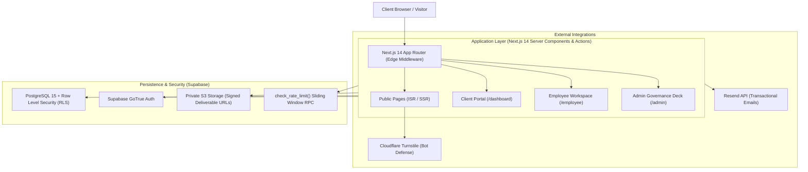
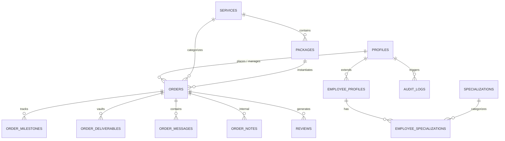

# Orvane Works System Architecture & Technical Specification

> **Engineering Reference Document for Orvane Works Studio**  
> *Next.js 14 App Router • TypeScript • Supabase Postgres • Tailwind CSS • Playwright*

---

## 1. High-Level Architecture Overview

Orvane Works is architected as an engineering-grade, database-driven digital studio platform. It unites a public-facing conversion studio with a multi-tenant client portal, a student employee workspace, and an executive admin governance deck.



---

## 2. Directory Structure

```
Orvane/
├── .agent/                    # Agentic coding instructions and operational rules
├── docs/                      # Architectural specs, brief, plan, screenshots, content guide
│   ├── ARCHITECTURE.md        # Comprehensive technical specification (this file)
│   ├── BRIEF.md               # Product requirements and stakeholder specifications
│   ├── CONTENT-GUIDE.md       # Studio admin operating manual
│   ├── PLAN.md                # 9-phase master implementation roadmap
│   └── screenshots/           # Responsive verification screenshots (360px, 768px, 1280px)
├── e2e/                       # Playwright end-to-end test suites
│   ├── client-order-flow.spec.ts
│   ├── contact-flow.spec.ts
│   └── employee-approval-flow.spec.ts
├── public/                    # Static brand assets, icons, logos, robots.txt, sitemap.xml
├── scripts/                   # Administrative automation and verification scripts
│   ├── capture-screenshots.mjs
│   ├── create-admin.mjs
│   └── seed.ts
├── src/
│   ├── app/                   # Next.js 14 App Router routes & API handlers
│   │   ├── (auth)/            # Auth routes: /login, /register, /join-team, /awaiting-approval
│   │   ├── (public)/          # Dynamic CMS pages: /, /services, /packages, /portfolio, /team, etc.
│   │   ├── admin/             # Admin Governance Deck (/admin)
│   │   ├── dashboard/         # Client portal (/dashboard, /orders, /settings)
│   │   ├── employee/          # Employee workspace (/employee, /profile)
│   │   └── api/               # Server API handlers and webhooks
│   ├── components/            # Reusable UI component library (shadcn/ui + custom tokens)
│   │   ├── ui/                # Accessible primitives (Radix UI + Tailwind)
│   │   ├── navigation/        # Header, mobile menu, dashboard nav
│   │   └── sections/          # Landing page sections, order cards, timeline
│   ├── hooks/                 # Custom React hooks (auth, media queries, rate limiting)
│   ├── lib/                   # Utilities, validations, Supabase clients, email engine
│   │   ├── email/             # Resend email templates & dispatch logic
│   │   ├── supabase/          # Client, server, and middleware Supabase clients
│   │   ├── validations/       # Zod schemas for all forms and database inputs
│   │   └── utils.ts           # Formatters (formatINR ₹, date formats, cn)
│   ├── middleware.ts          # Edge route guard and session synchronizer
│   └── test/                  # Vitest unit test suites
├── supabase/                  # Database migrations, RLS policies, seeds, and SQL helpers
│   ├── migrations/            # Version-controlled schema migrations
│   ├── create-first-admin.sql # First admin bootstrap SQL
│   └── seed.sql               # Foundational services, packages, and specializations seed
├── next.config.mjs            # Security headers (CSP, HSTS, frame-options)
├── playwright.config.ts       # E2E test configuration across 3 viewports
└── tailwind.config.ts         # Orvane design tokens (colors, typography, radii)
```

---

## 3. Database Schema & Data Model (21 Tables)

The database schema is organized into 5 logical domains:



### Table Catalog
1. `profiles`: Central user profile storing roles (`client`, `pending_employee`, `employee`, `admin`), account status, phone, and metadata.
2. `employee_profiles`: Extended records for approved student contributors (bio, institution, graduation year, GitHub, LinkedIn, avatar).
3. `services`: Data-driven service catalog (Web Dev, Video Editing, Content & Assets).
4. `packages`: Tiered pricing packages with features list, delivery timeframe, and INR prices.
5. `specializations`: Engineering and creative skill taxonomies.
6. `employee_specializations`: Join table linking employees to their technical specialties.
7. `portfolio_projects`: Showcase case studies with tags, metrics, and screenshots.
8. `orders`: Core commercial projects linking clients, lead engineers, package, quote, and stage.
9. `order_milestones`: 8-step chronological milestone tracker.
10. `order_deliverables`: Asset storage metadata with private signed download links.
11. `order_messages`: Real-time bidirectional project discussion thread between client and team.
12. `order_notes`: Private yellow-badged internal notes strictly visible to staff and admins.
13. `reviews`: Post-completion client feedback with 1-5 star ratings and admin moderation flags.
14. `contact_inquiries`: Spam-filtered prospective client inquiries.
15. `hardware_waitlist`: Student IoT and embedded systems prototyping interest queue.
16. `faqs`: Dynamic frequently asked questions grouped by category.
17. `team_applications`: Audit trail of student join requests and admin decisions.
18. `audit_logs`: Immutable, tamper-evident log of security and administrative operations.
19. `rate_limits`: Sliding-window timestamp buckets for IP and user request throttling.
20. `site_settings`: Global studio flags (maintenance mode, announcement banner).
21. `dpdp_requests`: India DPDP Act 2023 compliance audit log (data export and erasure requests).

---

## 4. Multi-Tenant Role Architecture & Security Boundaries

Orvane enforces zero-trust role segregation across 4 distinct personas:

```
┌────────────────────┐
│      Visitor       │ ──► Public Pages (/, /services, /portfolio, /contact, /team)
└────────────────────┘
          │ (Registers)
          ▼
┌────────────────────┐         ┌──────────────────────┐
│  Client (Standard) │         │   Pending Employee   │
│  Access: /dashboard│         │Access: /awaiting-app │
└────────────────────┘         └──────────────────────┘
                                          │
                                          │ (Admin Approval)
                                          ▼
                               ┌──────────────────────┐
                               │   Approved Employee  │
                               │ Access: /employee    │
                               └──────────────────────┘
                                          │
                                          │ (Explicit Elevation)
                                          ▼
                               ┌──────────────────────┐
                               │    Administrator     │
                               │ Access: /admin + ALL │
                               └──────────────────────┘
```

### Defense in Depth Layers
1. **Edge Middleware (`src/middleware.ts`)**:
   - Inspects Supabase session cookies before requests hit server components.
   - Redirects unauthenticated or unauthorized users to `/login?callbackUrl=...`.
2. **Server Actions & Route Handlers**:
   - Every mutation runs server-side with strict Zod schema validation.
   - Role checks are performed dynamically using `supabase.auth.getUser()`.
3. **PostgreSQL Row Level Security (RLS)**:
   - 100% of tables have RLS enabled (`alter table ... enable row level security;`).
   - Helper functions: `public.is_admin()`, `public.current_user_role()`.
   - Clients can **only** select and update their own orders, messages, and profiles.
   - Non-admins are prevented by triggers (`on_profile_role_update`) from self-escalating permissions.

---

## 5. Security Headers & Network Hardening

Configured in `next.config.mjs`:
- **Content Security Policy (CSP)**:
  - `default-src 'self'`
  - Script, style, image, and font sources locked to trusted domains (Supabase, Cloudflare Turnstile, Google Fonts).
- **HTTP Strict Transport Security (HSTS)**:
  - `max-age=63072000; includeSubDomains; preload`
- **Clickjacking Protection**: `X-Frame-Options: DENY`
- **MIME Sniffing Defense**: `X-Content-Type-Options: nosniff`
- **Referrer Policy**: `strict-origin-when-cross-origin`
- **Permissions Policy**: Camera, microphone, and geolocation disabled by default.

---

## 6. Rate Limiting & Anti-Abuse Architecture

All public submission endpoints (Contact, Waitlist, Team Application, Auth) are protected by a two-stage defense:
1. **Cloudflare Turnstile**: Zero-friction cryptographic bot verification on the frontend.
2. **PostgreSQL Sliding-Window Rate Limiter**:
   - Backed by the `public.check_rate_limit(p_key text, p_max_requests integer, p_window_seconds integer)` RPC function.
   - Automatically prunes expired request buckets and returns a boolean allow/deny decision.

---

## 7. Storage Vault Architecture

File storage is segregated into two Supabase buckets:
- **Public Bucket (`public-assets`)**:
  - Unrestricted read access for team avatars, portfolio thumbnails, and service icons.
- **Private Bucket (`order-deliverables`)**:
  - Restricted RLS policy: Only accessible by the client who owns the order, assigned employees, and admins.
  - Deliverable downloads are served strictly via time-limited signed URLs (`supabase.storage.createSignedUrl(path, 3600)`), expiring after 60 minutes.

---

## 8. Transactional Email System

Built on Resend and React Email (`src/lib/email/index.ts`), covering all **6 core studio events**:
1. **Contact Inquiry Received**: Auto-acknowledgement to sender + notification alert to `COMPANY_INBOX`.
2. **Order Received**: Confirmation to client with order reference number and dashboard link.
3. **Order Status Changed**: Real-time update dispatched whenever an order advances along the 8 milestones.
4. **Employee Application Decision**: Welcome onboarding email on approval, or constructive feedback email on rejection.
5. **New Message Notification**: Alert delivered when a team member or client posts a message in an order thread.
6. **Payment Received Confirmation**: Sent to client after each admin-recorded manual payment (UPI/bank/cash), including amount, type, method, and date.

---

## 9. India DPDP Act 2023 Compliance Architecture

In compliance with India's Digital Personal Data Protection Act 2023:
- **Explicit Consent**: Public forms include mandatory consent checkboxes referencing data processing terms.
- **Draft Legal Terms**: Privacy Policy (`/privacy`) and Terms (`/terms`) clearly marked *"Draft, pending legal counsel review"*.
- **Data Portability (`/dashboard/settings`)**: Clients can download a machine-readable JSON archive of all personal data, orders, messages, and uploaded files.
- **Right to Erasure**: Clients can initiate account deletion, which sanitizes personal profiles and logs the transaction to `dpdp_requests`.

---

## 10. Quality Assurance & Verification

- **TypeScript**: Strict type checking with `noImplicitAny: true` and 0 errors.
- **Unit Testing (Vitest)**: Testing permission logic, role matrix, and INR currency formatting utilities.
- **End-to-End Testing (Playwright)**:
  - 12 automated test runs across 3 viewports:
    - Mobile (360x640px)
    - Tablet (768x1024px)
    - Desktop (1280x800px)
  - Full journey coverage:
    - Flow 1: Client registration, protected route guards, new order creation, order detail view.
    - Flow 2: Employee applicant flow, awaiting approval holding view, admin queue approval, employee profile editor.
    - Flow 3: Contact inquiry form with Madurai coordinates and admin inbox verification.
- **Visual Evidence**: 27 responsive screenshots captured in `docs/screenshots/` across mobile, tablet, and desktop.

---

## 11. Manual Payments System (Phase D)

In Version 1, all payments are recorded manually by admin (no online payment gateway required).

### Table: `order_payments`
| Column | Type | Notes |
|---|---|---|
| `id` | uuid | PK |
| `order_id` | uuid | FK → `orders.id`, cascade delete |
| `amount_inr` | numeric(12,2) | Must be > 0 |
| `payment_type` | enum | `advance` / `balance` / `full` |
| `method` | enum | `upi` / `bank_transfer` / `cash` / `other` |
| `reference_utr` | text | nullable — UPI ref / bank UTR |
| `date_received` | date | Admin-entered date |
| `notes` | text | nullable — admin-only internal note |
| `recorded_by` | uuid | FK → `profiles.id` (admin) |
| `provider` | text | Always `'manual'` in v1 (Razorpay reserved) |
| `voided_at` | timestamptz | null = active; set = soft-deleted |
| `void_reason` | text | Required when voiding |
| `created_at` | timestamptz | Auto |

### RLS Policy Summary
- **Clients**: SELECT only for their own order payments. Application hides UTR and notes fields.
- **Employees**: SELECT for assigned orders — application shows payment status chip only (no amounts).
- **Admins**: Full CRUD.

### Auto-Status Sync Trigger
`trg_sync_order_payment_status` fires after every INSERT / UPDATE / DELETE on `order_payments`. It calls `sync_order_payment_status()` which:
1. Sums all non-voided `amount_inr` for the order.
2. Compares to `orders.quote_amount_inr`.
3. Sets `orders.payment_status` → `invoiced` / `partially_paid` / `paid_in_full`.

### Payment Status Calculation (Pure Function)
```
calculatePaymentStatus(quoteAmount, payments):
  totalPaid = sum of non-voided amounts
  if totalPaid == 0           → "Unpaid"
  if quoteAmount is null/0    → "Advance Received"
  if totalPaid >= quoteAmount → "Paid in Full"
  if totalPaid <= 60% of quote→ "Advance Received"
  else                        → "Partially Paid"
```
Tested in `src/__tests__/payments/payment-status.test.ts` (11 test cases).
